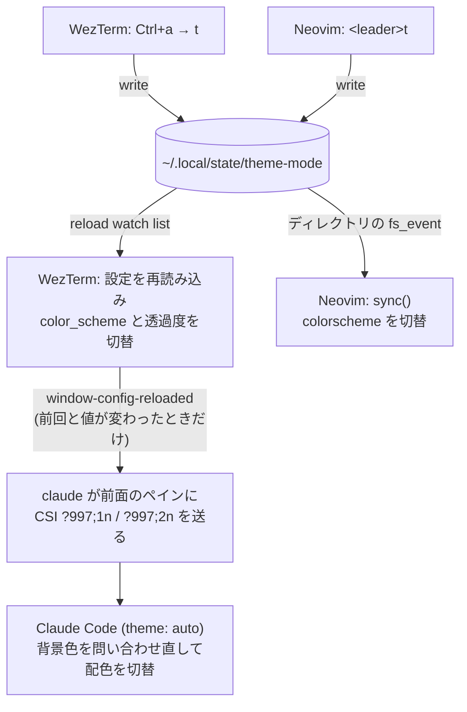

# ライト/ダーク配色の連動(WezTerm・Neovim・Claude Code)

WezTermの`Ctrl+a`→`t`、またはNeovimの`<leader>t`のどちらでトグルしても、WezTerm・Neovim・Claude Codeの3つの配色が同時に切り替わる仕組みの設計。

## 設計の核: 状態ファイル1つ

ライト/ダークの状態は、どのツールのメモリにも持たせず、次のファイル1つに置く。

```
~/.local/state/theme-mode    # 中身は "light" か "dark" の1行
```

- トグル操作はこのファイルを書き換えるだけにする
- 各ツールはこのファイルの変化を検知して、自分の配色を合わせる

こうしておくと、どのツールがトグルしたかを互いに知る必要がない。ツールを増やすときも「このファイルを監視して配色を当てる」処理を足すだけで済む。

## 全体の流れ



## ツールごとの実装

### WezTerm(`wezterm/config/theme.lua`)

状態ファイルを、WezTermの設定リロードの監視対象に登録する。ファイルが変わると設定全体が読み直され、その時点のファイルの中身で`color_scheme`と`window_background_opacity`が決まる。トグルキー(`keybinds.lua`の`EmitEvent("toggle-color-scheme")`)は、ファイルを書き換えるだけ。

```lua
wezterm.add_to_config_reload_watch_list(M.state_file)

local is_light = M.is_light()
config.color_scheme = is_light and M.light_scheme or M.dark_scheme
config.window_background_opacity = is_light and M.light_opacity or M.dark_opacity

wezterm.on("toggle-color-scheme", function(_, _)
  write_mode(not M.is_light())
end)
```

### Neovim(`nvim/lua/plugins/colorscheme.lua`)

libuvの`fs_event`で、状態ファイルのあるディレクトリを監視する。変化があれば`sync()`で配色を当て直す。ダークは`solarized-osaka.nvim`(背景透過)、ライトは`solarized.nvim`を使う。

```lua
local watcher = vim.uv.new_fs_event()
watcher:start(state_dir, {}, vim.schedule_wrap(function(err, filename)
  if not err and filename == vim.fs.basename(state_file) then
    sync() -- 前回と同じモードなら何もしない
  end
end))

vim.keymap.set("n", "<leader>t", function()
  vim.fn.writefile({ current == "dark" and "light" or "dark" }, state_file)
end)
```

### Claude Code(`claude/settings.json`とWezTerm側)

`claude/settings.json`は`"theme": "auto"`にしておく。Claude Codeは、端末からテーマ変更の通知(DEC mode 2031の`CSI ?997;{1=dark,2=light}n`)を受けると、背景色を問い合わせ直して配色を切り替える。

使っている版のWezTermはこの通知を自分では送らないため、WezTermの`window-config-reloaded`で代わりに送る。この文字列は他のプログラムには意味の分からない入力になるので、前面のプロセス名が`claude`のペインにだけ送る。

```lua
local seq = is_light and "\x1b[?997;2n" or "\x1b[?997;1n"
-- 全ウィンドウ・全タブ・全ペインを走査し、claude が前面のペインだけに送る
if (pane:get_foreground_process_name() or ""):match("claude[^/]*$") then
  pane:send_text(seq)
end
```

## ハマりどころと対処

| 場所 | 起きること | 対処 |
|---|---|---|
| WezTerm | 存在しないファイルは監視対象にできない | 初回起動時にファイルが無ければ`dark`で作る |
| WezTerm | リロードイベントはウィンドウの数だけ発火し、設定ファイルを編集したときにも発火する | 前回の値を、リロードをまたいで残る`wezterm.GLOBAL`に持つ。値が変わったときだけClaude Codeに通知する |
| Neovim | ファイルを置き換え(rename)で書くプログラムがあり、ファイル単体を監視していると監視が外れる | ファイルではなくディレクトリを監視し、ファイル名で絞り込む |
| Neovim | 1回の書き込みでイベントが複数回届く | 現在のモードを`current`に覚えておき、同じなら当て直さない |
| Neovim | 配色の切替時に`highlight clear`が走り、プラグインや自前で設定したハイライトが消える | `ColorScheme` autocmdで設定し直す(`bufferline.lua`・`nvim-tree.lua`・`options.lua`)。bufferlineは、アイコンのハイライトのキャッシュも自分で消す必要がある |
| Claude Code | WezTermがテーマ変更の通知を送らないので、`auto`にしても追従しない | WezTermのリロード時に、`claude`のペインへ通知の文字列を直接送る |

## 自分の環境に入れるとき

1. WezTerm: `wezterm/config/theme.lua`を取り込み、`wezterm.lua`で`require("config.theme").setup(config)`を呼ぶ。トグルキーには`wezterm.action.EmitEvent("toggle-color-scheme")`を割り当てる
2. Neovim: `nvim/lua/plugins/colorscheme.lua`を、lazy.nvimのプラグイン定義として置く。配色を変えたいときは`apply_dark`/`apply_light`の中身を差し替える
3. Claude Code: `~/.claude/settings.json`に`"theme": "auto"`を設定する
4. 確認: NeovimとClaude Codeを開いた状態でWezTermからトグルし、両方の色が変わるかを見る

- 状態ファイルのパス・配色名・透過度は、各ファイルの先頭で定義している
- Claude Codeへの通知は、WezTermがテーマ変更の通知を自分で送らない版を前提にした回避策。通知を送る版のWezTermでは、二重に届く可能性がある(未確認)
